# Guia: como alterar as plataformas e como a alteração chega ao site

Este guia é para quem cuida do **conteúdo** das plataformas (dicionário, enciclopédia, fauna,
plantas, fotos, gravações, páginas do portal) e não é programador. Ele mostra, passo a passo,
onde fica cada coisa, como mudar, o que acontece depois e o que fazer quando algo dá errado.

Os exemplos usam o Boe Eno Moto (Bororo, repositório `boeenomoto`), mas valem igualmente para
o Enawenê-Nawê (`enawenenawe`) e para as próximas plataformas.

**Sumário**

1. [Como tudo se encaixa](#1-como-tudo-se-encaixa)
2. [Onde fica cada coisa no repositório](#2-onde-fica-cada-coisa-no-repositório)
3. [Alterar pelo navegador, sem instalar nada](#3-alterar-pelo-navegador-sem-instalar-nada)
4. [Alterar no seu computador](#4-alterar-no-seu-computador)
5. [Quando algo dá errado](#5-quando-algo-dá-errado)
6. [Receitas para tarefas comuns](#6-receitas-para-tarefas-comuns)
7. [Atualizar o terradoc numa plataforma](#7-atualizar-o-terradoc-numa-plataforma)
8. [Começar uma plataforma nova](#8-começar-uma-plataforma-nova)
9. [Regras que importam](#9-regras-que-importam)
10. [Pequeno glossário](#10-pequeno-glossário)

---

## 1. Como tudo se encaixa

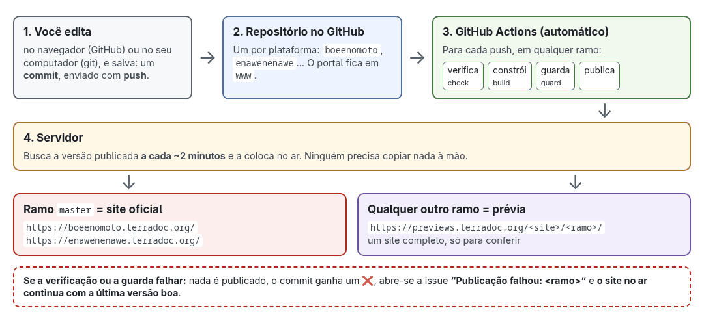

- **Cada plataforma é um repositório no GitHub**, na organização `plataformasindigenas`:
  `boeenomoto`, `enawenenawe`, e um novo para cada povo. O portal
  (<https://plataformas.terradoc.org/>) fica no repositório `www`, na pasta `portal/`.
- **O repositório é o site.** Os sites são gerados a partir dos arquivos de dados e de texto
  do repositório por um programa chamado **terradoc**. Ninguém edita as páginas HTML à mão.
- **Cada alteração salva e enviada ao GitHub (um *push*) dispara o GitHub Actions**, que faz
  quatro coisas, sozinho:
  1. **verifica** os dados (`terradoc check`): colunas, números repetidos, imagens e gravações
     citadas que não existem, consentimento;
  2. **constrói** o site completo (`terradoc build`);
  3. **guarda**: compara o site novo com o que está no ar e bloqueia se muita coisa sumiu de
     uma vez (`terradoc guard`);
  4. **publica** o site construído.
- **O servidor busca a nova versão a cada 2 minutos** e a coloca no ar. Contando a
  verificação e a construção (2 a 3 minutos), uma alteração aparece no site em **cerca de
  5 minutos**.
- **O ramo `master` é o site oficial.** Qualquer outro ramo vira uma **prévia**: um site
  completo, só para conferir, em `https://previews.terradoc.org/<site>/<ramo>/`. Por exemplo,
  o ramo `correcao-fauna` do Bororo aparece em
  `https://previews.terradoc.org/boeenomoto/correcao-fauna/`.

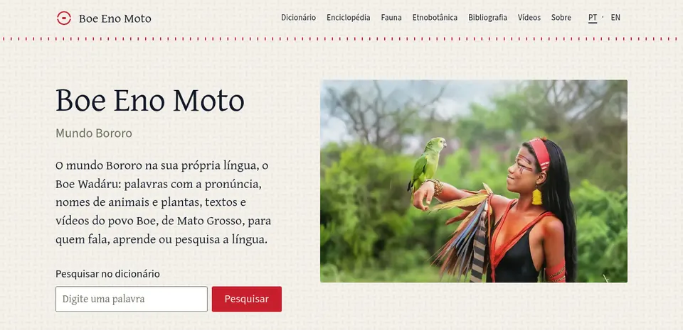

Todas as plataformas têm a mesma interface, com as cores, o alfabeto e os padrões de cada
povo. Esta é a letra A do dicionário Enawenê-Nawê
(<https://enawenenawe.terradoc.org/pt/dictionary/a.html>):

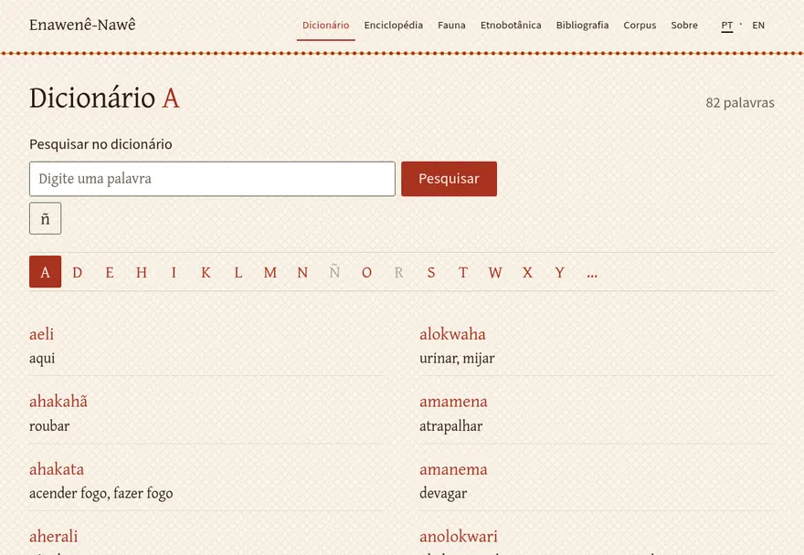

---

## 2. Onde fica cada coisa no repositório

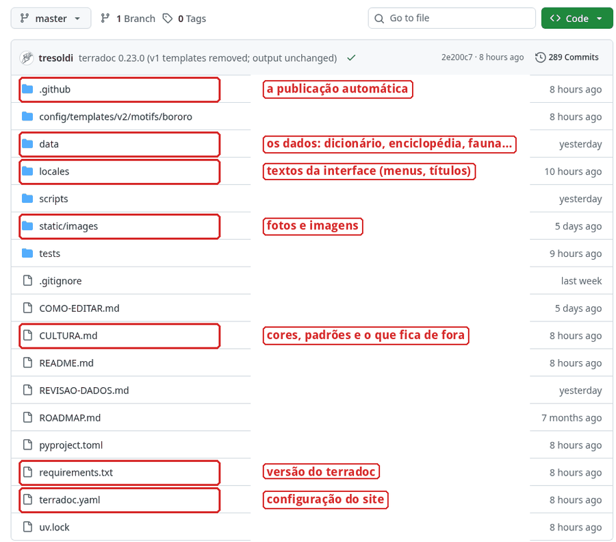

| O que | Onde | Formato |
|---|---|---|
| Dicionário | `data/dictionary.tsv` | tabela separada por tabulações, uma palavra por linha |
| Enciclopédia (verbetes) | `data/encyclopedia/<id>.md` | um arquivo por verbete: cabeçalho YAML e texto em Markdown |
| Categorias da enciclopédia | `data/categories.yaml` | lista das categorias permitidas (só no Bororo, por enquanto) |
| Animais (fauna) | `data/fauna.yaml` | YAML, um bloco por animal |
| Plantas (etnobotânica) | `data/ethnobotany.yaml` | YAML, um bloco por planta |
| Bibliografia | `data/bororo.bib` (Bororo), `data/references.bib` (Enawenê-Nawê) | BibTeX |
| Vídeos | `data/videos.yaml` | YAML, com o campo `consent` obrigatório |
| Gravações do dicionário | `data/audio/*.webm` | áudio em WebM |
| Consentimento das gravações | `data/audio/manifest.tsv` | tabela: arquivo, id da palavra, código do falante, consentimento |
| Fotos e imagens | `static/images/` | JPG, PNG ou WebP; copiadas para o site |
| Créditos das fotos | junto de cada foto: `pic_credit` e `pic_source` (fauna, plantas), `credit` (enciclopédia), `theme.hero_credit` (foto da página inicial) | texto |
| Textos da interface (menus, títulos, apresentação) | `locales/pt.yaml`, `locales/en.yaml` | YAML |
| Cores, padrões e o que fica de fora | `CULTURA.md` (explicação) e `config/templates/v2/motifs/<povo>/` (desenhos) | texto e SVG |
| Configuração do site (nome, idiomas, alfabeto, cores, foto inicial) | `terradoc.yaml` | YAML |
| Versão do terradoc | `requirements.txt` | uma linha: `terradoc==0.23.0` |
| Publicação automática | `.github/workflows/site.yml` e `.github/CODEOWNERS` | não mexa sem falar com o Tiago |
| Pendências nos dados (homônimos, definições vazias…) | `REVISAO-DADOS.md` | lista de trabalho para a equipe |

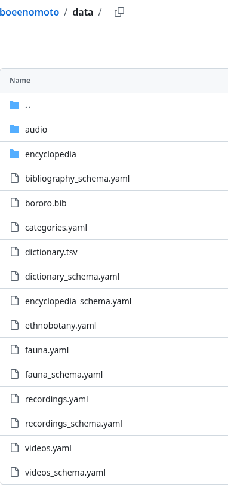

Não procure os arquivos `data/*.json` nem a pasta `docs/`: eles são gerados na construção e
não fazem parte do repositório.

O GitHub mostra a tabela do dicionário como uma planilha. A coluna `id` é o número da palavra
(nunca o reutilize), `entry` é a palavra, `ipa` a pronúncia, `pos` a classe gramatical (o
Bororo aceita só uma lista fixa de valores, como `LEX`, `S`, `V`), `definition` a tradução.

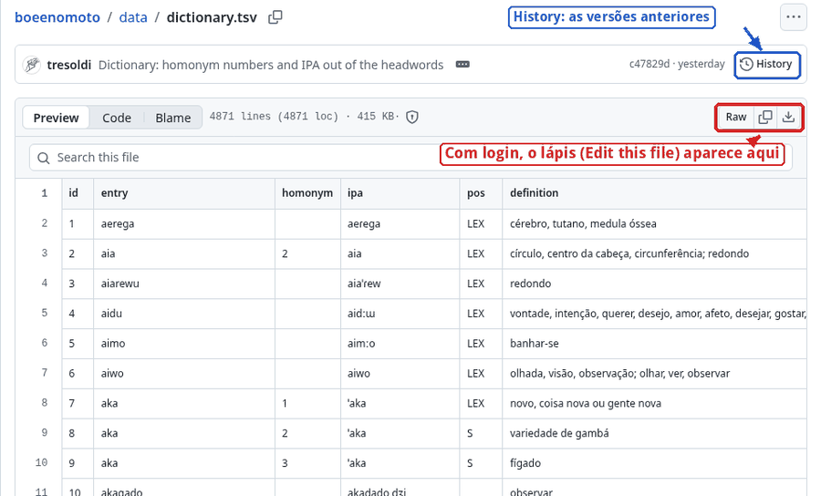

E é assim que essa linha aparece no site:

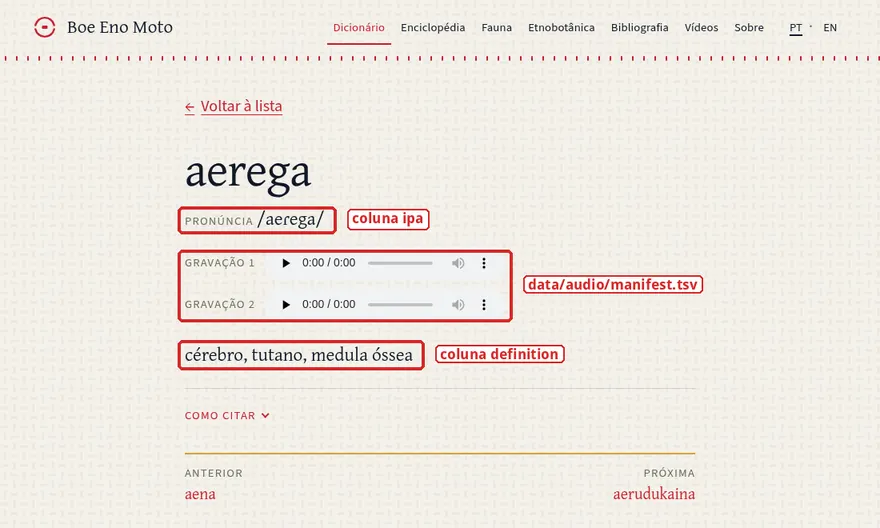

---

## 3. Alterar pelo navegador, sem instalar nada

Você precisa de uma conta no GitHub com acesso de escrita ao repositório (peça ao Tiago).
As capturas de tela abaixo foram feitas sem login; **com login, aparecem os botões de edição**
(o lápis, *Add file*, *Commit changes…*).

### 3.1 Editar um arquivo

1. Abra o repositório, por exemplo <https://github.com/plataformasindigenas/boeenomoto>, e
   entre nas pastas até o arquivo (`data` → `dictionary.tsv`).
2. Clique no **lápis** (*Edit this file*), no canto direito, acima do conteúdo (ver a
   imagem da seção 2).
3. Faça a alteração. Para corrigir uma palavra numa tabela `.tsv`, mude só o texto dentro da
   célula; não apague nem acrescente tabulações.

### 3.2 Salvar num ramo novo (recomendado)

4. Clique em **Commit changes…** (botão verde, no alto).
5. Em *Commit message*, escreva em uma linha o que mudou, por exemplo
   `Dicionário: corrige a definição de aerega`.
6. Escolha **Create a new branch for this commit and start a pull request**. O GitHub sugere
   um nome como `seu-usuario-patch-1`; pode manter, ou escrever algo como `corrige-aerega`
   (use só letras minúsculas, números e hífens).
7. Clique em **Propose changes**. O GitHub abre a página do *pull request*; você pode criá-lo
   agora ou depois (passo 11).

Se a alteração for pequena e você tiver certeza, pode escolher **Commit directly to the
`master` branch**: ela vai direto para o site oficial, sem prévia. Mesmo assim ela é
verificada antes; um erro não chega ao site.

### 3.3 Abrir a prévia

8. Abra a aba **Actions** do repositório. A execução da sua alteração aparece no alto, com o
   nome do ramo ao lado. Uma bolinha amarela quer dizer "rodando"; um sinal verde, "deu certo";
   um X vermelho, "falhou" (veja a [seção 5](#5-quando-algo-dá-errado)).

   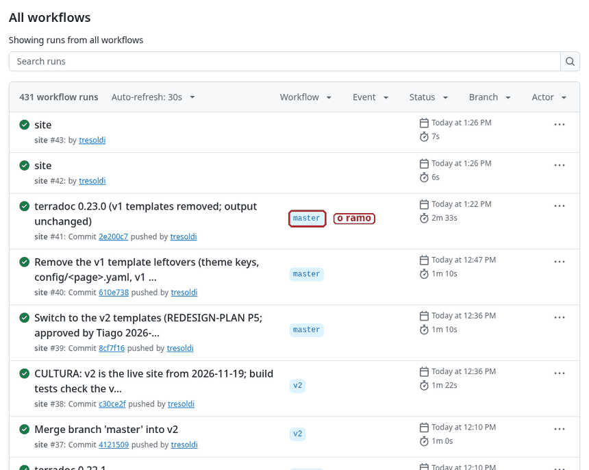

9. Quando ficar verde, espere até 2 minutos e abra a prévia:
   `https://previews.terradoc.org/boeenomoto/<nome-do-ramo>/`. A lista de prévias de cada
   site fica em `https://previews.terradoc.org/<site>/` (por exemplo
   <https://previews.terradoc.org/boeenomoto/>). Com login, a página da execução também mostra
   o link da prévia, sob **Publicado / Published**.

   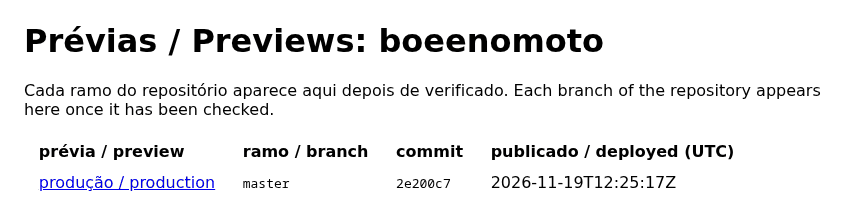

   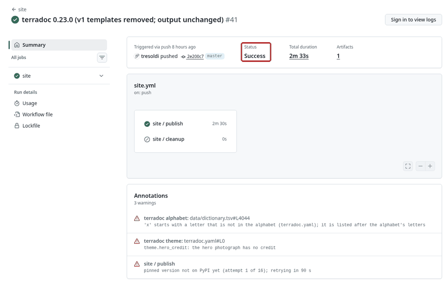

   Os avisos (triângulos amarelos) em *Annotations* não bloqueiam nada: são coisas a melhorar,
   como uma foto sem crédito.

### 3.4 Conferir

10. Na prévia, procure a palavra, o verbete ou a foto que você mudou e confira o resultado,
    em português e em inglês. Se precisar corrigir algo, edite de novo **no mesmo ramo** (no
    GitHub, escolha o ramo no seletor de ramos, no alto à esquerda, antes de abrir o arquivo).
    A prévia se atualiza sozinha.

### 3.5 Levar para o site oficial

11. Abra a aba **Pull requests** → **New pull request** (ou o aviso amarelo *Compare & pull
    request*), escolha o seu ramo e clique em **Create pull request**. Escreva o que mudou.
    É aqui que outra pessoa pode revisar.
12. Clique em **Merge pull request** → **Confirm merge**. Isso junta o seu ramo ao `master`.
13. Clique em **Delete branch**. A prévia desaparece sozinha, uns 10 minutos depois.

### 3.6 Ver no ar

14. Na aba **Actions** aparece uma nova execução, agora no ramo `master`. Quando ela ficar
    verde, espere até 2 minutos e abra o site oficial: <https://boeenomoto.terradoc.org/>.
    Se a página antiga continuar aparecendo, recarregue-a (Ctrl+Shift+R, ou Cmd+Shift+R no Mac).

### 3.7 Enviar arquivos novos (fotos, gravações, verbetes)

Entre na pasta (por exemplo `static/images`), clique em **Add file** → **Upload files**,
arraste os arquivos e salve como no passo 4 em diante. Para um verbete novo, use
**Add file** → **Create new file** dentro de `data/encyclopedia/`.

---

## 4. Alterar no seu computador

Vale a pena para mudanças grandes (muitas linhas, muitos arquivos) e para ver o site antes de
enviar. Você precisa de **git** e **Python 3.12** (a mesma versão usada na publicação).

### 4.1 Uma vez só: copiar o repositório e instalar o terradoc

```sh
git clone https://github.com/plataformasindigenas/boeenomoto.git
cd boeenomoto
python3 -m venv .venv
source .venv/bin/activate          # no Windows: .venv\Scripts\activate
pip install -r requirements.txt
```

O `requirements.txt` instala **exatamente a versão do terradoc que o site usa**, para que o
resultado no seu computador seja igual ao da publicação. A pasta `.venv` não vai para o
repositório.

Nas próximas vezes, basta entrar na pasta, ativar o ambiente (`source .venv/bin/activate`) e
trazer as novidades:

```sh
git switch master
git pull
pip install -r requirements.txt    # só muda algo se a versão do terradoc mudou
```

### 4.2 Criar um ramo e editar

```sh
git switch -c corrige-fauna
```

Edite os arquivos com o editor de sua preferência. Para as tabelas `.tsv` você pode usar o
LibreOffice Calc: ao salvar, escolha **Texto CSV**, separador **tabulação**, codificação
**UTF-8**, sem aspas em volta do texto.

### 4.3 Verificar

```sh
terradoc check
```

Leva alguns segundos e não escreve nada. Cada problema aparece com o arquivo e a linha. Os
**erros** (`ERROR`) impedem a publicação; os **avisos** (`WARNING`) não. Exemplo com quatro
erros (feitos de propósito, numa cópia):

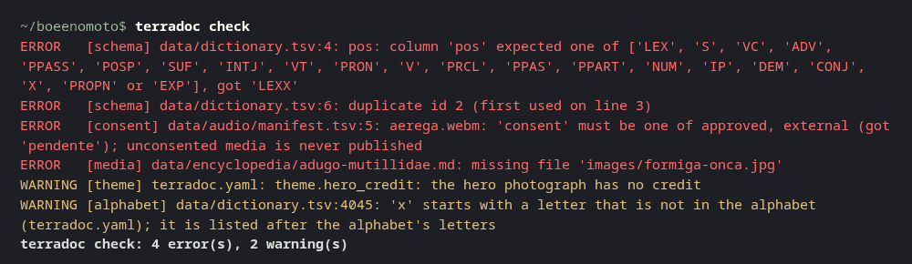

Como ler:

- `data/dictionary.tsv:4: pos: … got 'LEXX'`: na linha 4 da tabela, a classe gramatical
  `LEXX` não está na lista permitida (o certo era `LEX`).
- `duplicate id 2 (first used on line 3)`: duas linhas com o mesmo número na coluna `id`.
- `[consent] … 'consent' must be one of approved, external`: uma gravação sem consentimento
  registrado. Não é publicada, e a publicação inteira é bloqueada até corrigir.
- `[media] … missing file 'images/formiga-onca.jpg'`: o verbete cita uma foto que não está em
  `static/images/` (nome errado ou foto não enviada).

### 4.4 Construir e abrir o site no seu computador

```sh
terradoc build --out /tmp/site
```

(No Windows, use outra pasta, por exemplo `--out C:\temp\site`.) O comando roda o `check`
primeiro e para se houver erro. O Bororo, com mais de 11 000 páginas, leva menos de um
minuto. Ele também lista as fotos que estão no site sem crédito:

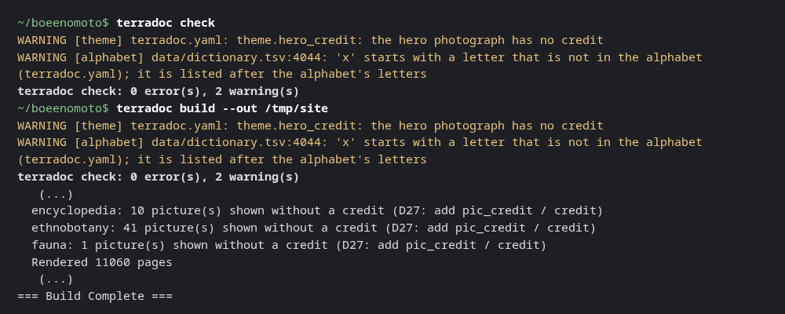

Abra no navegador o arquivo `/tmp/site/pt/index.html` (ou arraste-o para uma janela do
navegador) e navegue até o que você mudou:

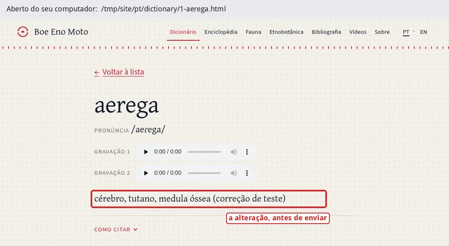

Para reconstruir do zero, apagando a versão anterior: `terradoc build --out /tmp/site --clean`.

A construção também deixa alguns arquivos `data/*.json` na sua cópia: são intermediários, o git
os ignora. Se preferir que fiquem fora, acrescente `--bundle-dir /tmp/bundle`.

### 4.5 Enviar

```sh
git add data/fauna.yaml static/images/fauna_200_novo.jpg
git commit -m "Fauna: acrescenta ..."
git push -u origin corrige-fauna
```

Depois disso, tudo segue como no navegador: a prévia em
`https://previews.terradoc.org/boeenomoto/corrige-fauna/`, o *pull request*, o *merge*
([passos 8 a 14](#33-abrir-a-prévia)).

---

## 5. Quando algo dá errado

**Nada quebrado chega ao site: o site no ar continua com a última versão boa.** Uma
alteração com erro fica parada até alguém corrigi-la.

### 5.1 Como você fica sabendo

1. O commit ganha um **X vermelho** no GitHub, e a execução na aba **Actions** aparece como
   *Failure*.
2. Na página da execução, em **Annotations**, cada problema aparece com o arquivo e a linha.
   Na página do commit, as mesmas anotações aparecem **ao lado da linha** do arquivo.

   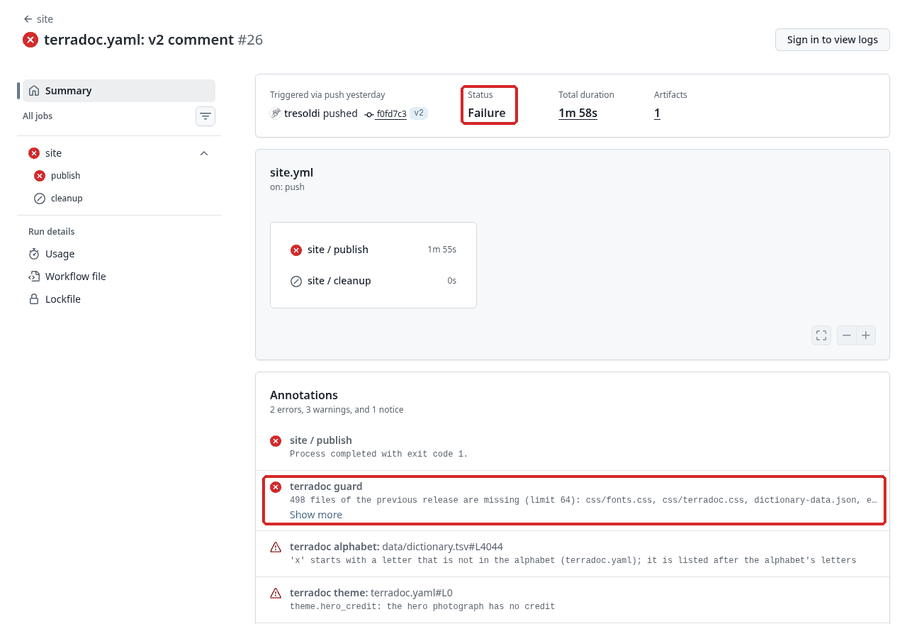

3. Abre-se uma *issue* chamada **"Publicação falhou: &lt;ramo&gt;"**, que explica cada
   problema numa tabela, em português e inglês, com o link da execução. Ela menciona quem
   enviou a alteração e os responsáveis pelos arquivos (`.github/CODEOWNERS`), e o GitHub manda
   um e-mail. Se houver muitos erros, a lista completa está na issue.

   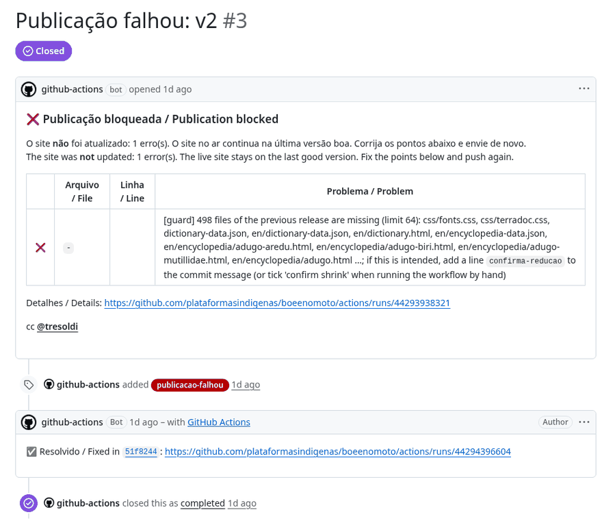

4. Corrija e envie de novo, no mesmo ramo. Quando a próxima execução der certo, a issue se
   fecha sozinha ("Resolvido / Fixed").

Erros comuns: um `id` repetido no dicionário; uma linha com uma coluna a mais ou a menos;
uma classe gramatical fora da lista; uma foto ou gravação citada que não existe; uma
gravação ou vídeo sem `consent`; uma página do portal que existe em um idioma e falta em outro.

### 5.2 A guarda: apagar muito de uma vez é bloqueado

A guarda compara o site novo com o que está no ar (no caso de uma prévia nova, com o site
oficial) e **bloqueia** quando:

- uma seção (dicionário, fauna, enciclopédia…) perde **mais de 20 registros, ou mais de 10 %**
  deles;
- o site perde **mais de 10 arquivos publicados** (páginas, fotos, gravações); num site grande o
  limite é 5 % dos arquivos (no Bororo, algumas centenas).

Isso protege contra acidentes, como uma tabela salva pela metade. **Se a redução for de
propósito**, escreva numa linha da mensagem do commit:

```text
confirma-reducao
```

No navegador, ponha `confirma-reducao` no campo *Extended description*, abaixo da mensagem do
commit. Basta estar em um dos commits enviados naquele push. A guarda então só avisa e deixa
publicar. A issue de exemplo acima é justamente um bloqueio da guarda.

### 5.3 Como desfazer uma alteração que já está no ar

- **Pelo navegador, se a alteração entrou por *pull request*:** abra o *pull request* já
  juntado e clique em **Revert**. O GitHub cria um novo *pull request* que desfaz tudo; junte-o
  ao `master`.
- **Pelo navegador, se a alteração foi direto ao `master`:** abra o arquivo, clique em
  **History**, abra a versão anterior, copie o conteúdo e salve-o por cima da versão atual
  (um novo commit).
- **No computador:** `git revert <commit>` e `git push`. O código do commit (como `2e200c7`)
  aparece no histórico.

Desfazer é uma alteração como outra qualquer: passa pela verificação e chega ao site em
poucos minutos.

**Qualquer coisa que precise acontecer no servidor** (voltar o site a uma versão anterior
imediatamente, tirar um arquivo de todas as versões guardadas, uma prévia que não aparece) é
um **pedido ao Tiago**.

---

## 6. Receitas para tarefas comuns

### 6.1 Corrigir uma palavra

1. Abra `data/dictionary.tsv` e localize a linha (no GitHub, use *Search this file*; no
   computador, a busca do editor).
2. Corrija o texto na coluna certa (`entry`, `ipa`, `definition`, `example_sent`…). Não mude o
   `id`.
3. Salve num ramo, confira a prévia, junte ao `master` ([seção 3](#3-alterar-pelo-navegador-sem-instalar-nada)).

Homônimos: não escreva o número na palavra; use a coluna `homonym` (1, 2, …), e o site mostra
*aka*¹, *aka*². O arquivo `REVISAO-DADOS.md` lista os casos ainda pendentes.

### 6.2 Acrescentar uma palavra com gravação

1. **Antes de tudo: a gravação tem consentimento para ser publicada?** Se não tiver (ou se
   ainda estiver pendente), pare aqui e guarde o arquivo fora do repositório.
2. **A linha do dicionário.** Acrescente uma linha ao fim de `data/dictionary.tsv`, com um
   `id` novo (o maior número existente mais um; nunca reutilize um número apagado). O jeito
   mais seguro de manter as tabulações é copiar uma linha existente e trocar o conteúdo.
3. **O arquivo de áudio.** Converta a gravação para WebM, por exemplo com o programa ffmpeg:

   ```sh
   ffmpeg -i aerega.wav -c:a libopus -b:a 48k aerega.webm
   ```

   Dê ao arquivo o nome da palavra, sem acentos nem espaços. Uma segunda gravação da mesma
   palavra leva `__` e um código: `aerega__s03.webm`. **Nunca ponha o nome de uma pessoa no
   nome do arquivo**: o nome do arquivo aparece no endereço da gravação, no site.
4. Envie o arquivo para `data/audio/`.
5. **O registro de consentimento.** Acrescente uma linha a `data/audio/manifest.tsv`, com as
   quatro colunas separadas por tabulação:

   | file | entry_id | speaker | consent |
   |---|---|---|---|
   | `aerega__s03.webm` | `1` | `s03` | `approved` |

   - `file`: o nome do arquivo em `data/audio/`;
   - `entry_id`: o `id` da palavra no dicionário (uma gravação de homófonos pode ter uma linha
     para cada palavra);
   - `speaker`: um **código** do falante, como `s03` (de 1 a 4 letras minúsculas e de 1 a 3
     algarismos), nunca o nome; pode ficar vazio. O código **não** é publicado; a lista que liga
     códigos a pessoas fica fora do repositório;
   - `consent`: `approved` quando a comunidade aprovou a publicação.
6. Salve tudo **no mesmo ramo** (um commit ou vários) e confira a prévia: a página da palavra
   ganha um tocador "Gravação 1", "Gravação 2"…

A verificação bloqueia: um arquivo `.webm` em `data/audio/` que não esteja no
`manifest.tsv`; uma linha do manifesto cujo arquivo não existe; um `entry_id` que não está no
dicionário; um `consent` diferente de `approved` ou `external`; um código de falante que
pareça um nome.

### 6.3 Acrescentar uma foto com crédito

1. Confirme que a foto **pode** ser publicada: é de vocês com autorização de quem aparece
   nela, ou tem licença aberta (Wikimedia Commons, iNaturalist com licença CC…).
2. Envie a foto para `static/images/` com um nome sem espaços nem acentos, por exemplo
   `fauna_200_tuiuiu.jpg`. Fotos grandes demais deixam o site lento: 1600 pixels de largura
   bastam.
3. Ligue a foto ao registro, **sempre com o crédito**:

   - **Fauna ou plantas** (`data/fauna.yaml`, `data/ethnobotany.yaml`):

     ```yaml
       pic_link: images/fauna_200_tuiuiu.jpg
       pic_credit: "© Nome do autor, CC BY-SA 4.0, via Wikimedia Commons"
       pic_source: "https://commons.wikimedia.org/wiki/File:..."
     ```

     `pic_source` é o endereço da foto original (precisa começar com `https://`) e vira um
     link no crédito.
   - **Enciclopédia**, no cabeçalho do verbete:

     ```yaml
     images:
     - url: images/enc_tuiuiu_0.jpg
       alt: Tuiuiú pousado à beira do rio
       credit: "© Nome do autor, CC BY 4.0"
     ```

     `alt` descreve o que a foto mostra, para quem não a vê.
   - **Foto da página inicial**: `theme.hero_image`, `theme.hero_alt` e `theme.hero_credit` em
     `terradoc.yaml`.
   - **Páginas do portal**: o crédito vai entre aspas depois do caminho:
     ``.
4. Salve num ramo e confira a prévia.

Uma foto citada que não existe é um **erro**. Uma foto sem crédito é só um **aviso**, mas
a regra do projeto é que toda foto tenha crédito (a construção lista quantas faltam).

### 6.4 Escrever um verbete da enciclopédia

1. Escolha o **id**: letras minúsculas sem acento, números e hífens (`adugo`,
   `aroe-maiwu`). O nome do arquivo é o id: `data/encyclopedia/aroe-maiwu.md`.
2. Escreva o arquivo, com o cabeçalho entre as duas linhas `---`:

   ```markdown
   ---
   id: aroe-maiwu
   title: Aroe Maiwu
   variants: []
   abstract: Uma ou duas frases que resumem o verbete (aparecem na lista e nas buscas).
   categories:
   - cosmologia/espírito
   images: []
   references:
   - Albisetti1962aEnciclopedia
   see_also:
   - aroe
   ---

   O texto do verbete, em Markdown: parágrafos separados por uma linha em branco,
   **negrito**, *itálico*, listas com `-`, títulos com `##`.
   ```

   - `categories`: no Bororo, cada categoria precisa estar em `data/categories.yaml`. Para
     criar uma nova, acrescente-a lá também.
   - `references`: as chaves das obras em `data/bororo.bib` (a palavra depois de
     `@article{` ou `@book{`). Uma chave que não existe é erro: acrescente a obra ao `.bib`
     primeiro.
   - `see_also`: ids de outros verbetes que existem.
   - `images`: veja a [receita 6.3](#63-acrescentar-uma-foto-com-crédito).
3. Salve num ramo (no navegador: **Add file** → **Create new file** dentro de
   `data/encyclopedia/`) e confira a prévia.

### 6.5 Acrescentar ou mudar uma página do portal

O portal <https://plataformas.terradoc.org/> é feito pelo terradoc a partir de páginas em
Markdown, no repositório `www`, pasta `portal/`, e é publicado pelo arquivo
`.github/workflows/publish.yml` desse repositório. As prévias ficam em
`https://previews.terradoc.org/plataformas/<ramo>/`.

> **Situação em 2026-11-19:** o portal feito pelo terradoc está no ramo `v2` do `www`. Até o
> Tiago juntar esse ramo ao `master`, o portal no ar é a versão antiga, e as páginas abaixo
> estão no ramo `v2`. Comece os seus ramos a partir dele.

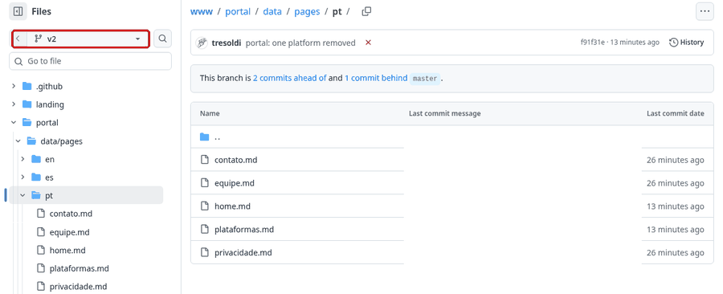

1. Cada página é um arquivo `portal/data/pages/<idioma>/<nome>.md`. **A mesma página existe em
   português, inglês e espanhol, com o mesmo nome de arquivo** (`pt/equipe.md`, `en/equipe.md`,
   `es/equipe.md`); a verificação acusa uma página que falte num idioma.
2. O cabeçalho:

   ```markdown
   ---
   title: Equipe                       # obrigatório: o título e o nome no menu
   description: Quem faz o projeto.    # opcional: a frase de abertura
   nav: 2                              # opcional: entra no menu, nesta ordem
   aliases: [equipe.html]              # opcional: endereços antigos que levam para cá
   ---
   O texto, em Markdown (sem HTML).
   ```

3. O nome do arquivo usa só `a-z`, `0-9` e `-`, e vira o endereço: `pt/equipe.html`.
4. Fotos vêm de `portal/static/images/`, com crédito
   ([receita 6.3](#63-acrescentar-uma-foto-com-crédito)). Fotos de outros sites não são
   aceitas: use um link.
5. Uma lista em que cada item tem uma foto vira um conjunto de cartões (como a página da
   equipe).
6. `home.md` é o texto da página inicial, abaixo da foto.

### 6.6 Retirar algo a pedido (consentimento retirado)

Quando alguém pede para retirar uma gravação, uma foto ou um texto:

1. **Avise o Tiago imediatamente**, dizendo exatamente o quê (arquivo, palavra, verbete) e em
   qual plataforma. O site guarda versões anteriores no servidor, e só ele pode tirar o arquivo
   de todas elas; ele também cuida do histórico do GitHub e das cópias de dados que cada
   execução guarda por 30 dias.
2. **Tire do repositório**, num commit (pode ser direto no `master`, pela urgência):
   - uma gravação: apague o arquivo de `data/audio/` **e** a linha dele em `manifest.tsv`;
   - uma foto: apague o arquivo de `static/images/` **e** a referência a ele (`pic_link`,
     `images:` do verbete), com o crédito;
   - um texto ou registro: apague o verbete ou a linha.
3. Se forem muitos itens de uma vez, a guarda vai bloquear: use `confirma-reducao`
   ([seção 5.2](#52-a-guarda-apagar-muito-de-uma-vez-é-bloqueado)).

Os dois passos são necessários: se o arquivo sair só do servidor, a próxima publicação o traz
de volta; se sair só do repositório, as versões guardadas ainda o têm. **Apagar do repositório
não apaga do histórico do git**: por isso o cuidado está antes, em nunca enviar o que não tem
consentimento ([seção 9](#9-regras-que-importam)).

---

## 7. Atualizar o terradoc numa plataforma

Cada plataforma usa **uma versão fixa** do terradoc, escrita em dois lugares que precisam
concordar:

- `requirements.txt`: `terradoc==0.23.0`;
- `.github/workflows/site.yml`: a linha
  `uses: plataformasindigenas/terradoc/.github/workflows/site.yml@<código>  # v0.23.0`.

Assim, uma versão nova do terradoc **nunca muda um site sozinha**. Quem atualiza é o **Tiago**:
ele lança a versão nova, confere que todas as plataformas continuam construindo do mesmo jeito
e então muda as duas linhas em cada repositório, num commit como
`terradoc 0.24.0 (…)`. Você não precisa fazer nada; depois de uma atualização, basta rodar de
novo `pip install -r requirements.txt` na sua cópia local.

Se você precisar de algo novo no terradoc (um campo, uma página, um texto da interface),
peça ao Tiago.

---

## 8. Começar uma plataforma nova

Duas plataformas novas já começaram, em 2026-11-19: **Haliti-Paresi** (repositório `paresi`) e
**Terena** (`terena`). Por enquanto têm só a enciclopédia e a bibliografia, a partir de fontes
publicadas, e estão em prévia no ramo `inicio`
(<https://previews.terradoc.org/paresi/inicio/>, <https://previews.terradoc.org/terena/inicio/>);
o `master` só recebe o site quando a comunidade o tiver visto. As cores e os desenhos de cada uma,
e o que ainda falta combinar com a comunidade (o alfabeto, por exemplo), estão no `CULTURA.md`
de cada repositório. Os dados da pesquisa de campo entram nesses repositórios, no ramo `inicio`.

Para uma plataforma ainda mais nova, o trabalho se divide assim.

### O que você prepara

1. **Consentimento e acordo com a comunidade**: o que pode ser publicado, quem aprova (pode
   ser um papel, como "coordenador", em vez de um nome) e o que fica de fora.
2. **O nome da plataforma** (de preferência na própria língua) e um endereço curto, sem
   acentos, que vira o nome do repositório e o endereço do site:
   `https://<nome>.terradoc.org/`.
3. **O código da língua** (ISO 639-3) e **o alfabeto**: as letras e a ordem em que o dicionário
   deve ser organizado, incluindo dígrafos, a partir de uma fonte publicada (cite-a).
4. **O dicionário** numa tabela com as colunas `id`, `entry`, `ipa`, `pos`, `definition`,
   `example_sent` (e as outras que fizerem sentido), um número único por linha.
5. **Os textos de apresentação**: subtítulo, uma frase de abertura, o "Sobre", em português e
   inglês.
6. **Fotos**: uma para a página inicial (dizendo se mostra pessoas), e as outras com crédito
   e autorização.
7. **Cores**: cinco cores com papéis (fundo, texto, títulos e links, faixas, texto
   secundário), cada uma com o material de onde vem (urucum, argila, jenipapo…). Padrões
   gráficos do povo **só com aprovação da comunidade**; sem isso, o site usa o padrão neutro
   do terradoc e fica completo assim mesmo.
8. **O primeiro `CULTURA.md`**: de onde vêm as cores e os padrões, quem aprovou e quando, e o
   que ficou de fora de propósito (veja os do Bororo e do Enawenê-Nawê como modelo).
9. Se houver: verbetes, fauna, plantas, bibliografia (`.bib`), gravações com o registro de
   consentimento.

### O que o Tiago faz

- cria o repositório em `plataformasindigenas`, a partir do modelo do terradoc
  (`terradoc init`), com a publicação automática e o `CODEOWNERS`;
- prepara o servidor e o endereço (DNS) do novo site;
- acrescenta a plataforma ao portal e às verificações do terradoc.

Depois disso, a plataforma nova funciona exatamente como as outras: você edita, a prévia
aparece, o `master` é o site oficial.

---

## 9. Regras que importam

1. **Tudo o que é enviado é público.** Os repositórios são públicos. Qualquer arquivo enviado a
   **qualquer ramo**, inclusive uma prévia, fica visível para todos, e **apagar depois não
   resolve**: o histórico do git guarda tudo, e só o suporte do GitHub consegue remover de
   verdade. As mensagens de commit também são públicas.
2. **Consentimento primeiro.** Material com consentimento pendente **nunca** é enviado:
   guarde-o fora do repositório até a comunidade aprovar. Cada gravação e cada vídeo precisa de
   `consent`:
   - `approved`: a comunidade aprovou que este site publique o material;
   - `external`: um vídeo público de outra pessoa que o site só incorpora (YouTube, por
     exemplo).
   Sem um desses dois valores, a publicação é bloqueada. Se algo for enviado por engano, avise
   o Tiago imediatamente ([receita 6.6](#66-retirar-algo-a-pedido-consentimento-retirado)).
3. **Nenhum nome de falante nos sites, por enquanto.** No `manifest.tsv` vai um código (`s01`),
   nunca um nome; também nada de nomes nos nomes de arquivos, nas legendas ou nos verbetes, até
   que isso seja combinado com as comunidades.
4. **Toda foto tem crédito** (autor, licença, fonte) e autorização de quem aparece nela.
   Qualquer foto pode ser retirada a pedido.
5. **Nada restrito ou sagrado.** Conhecimento, objetos, cantos, pinturas e imagens de uso
   restrito (rituais, funerários, de clã ou de família) não entram nos sites, nem como
   inspiração. Na dúvida, não publique e pergunte.
6. **Os padrões pertencem aos povos.** As cores, a faixa, a textura e o emblema de cada site
   vêm daquele povo, estão explicados no `CULTURA.md` do site e **não são usados no site de
   outro povo**. Mudanças nesses elementos passam pela aprovação registrada no `CULTURA.md`.

---

## 10. Pequeno glossário

| Termo | O que é |
|---|---|
| **repositório** | a pasta do projeto no GitHub, com todo o histórico; um por plataforma |
| **commit** | uma alteração salva, com uma mensagem que diz o que mudou |
| **push** | enviar os seus commits para o GitHub (no navegador, acontece ao salvar) |
| **ramo** (*branch*) | uma linha de trabalho separada; `master` é o site oficial, os outros viram prévias |
| **prévia** | o site completo construído a partir de um ramo, só para conferir |
| ***pull request*** | o pedido para juntar um ramo ao `master`, onde a mudança pode ser revisada |
| ***merge*** | juntar um ramo ao `master`; é o que leva a mudança ao site oficial |
| ***revert*** | um commit novo que desfaz um commit anterior |
| **GitHub Actions** | o serviço do GitHub que verifica, constrói e publica a cada push |
| ***issue*** | um aviso ou pedido registrado no repositório; "Publicação falhou" é aberta automaticamente |
| **TSV** | tabela em texto, com as colunas separadas por tabulações |
| **YAML** | formato de texto com `chave: valor`, em que a indentação (espaços) importa |
| **Markdown** | texto com marcações simples: `**negrito**`, `*itálico*`, `## título` |

Dúvidas: pergunte ao Tiago. Detalhes técnicos de como a publicação funciona estão em
[`docs/publishing.md`](../publishing.md).
